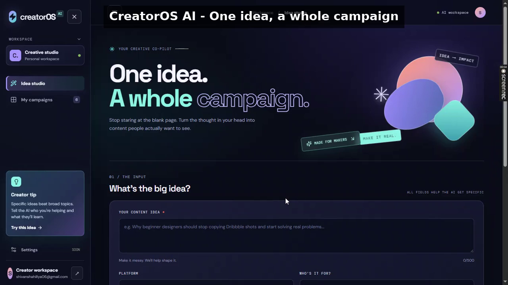
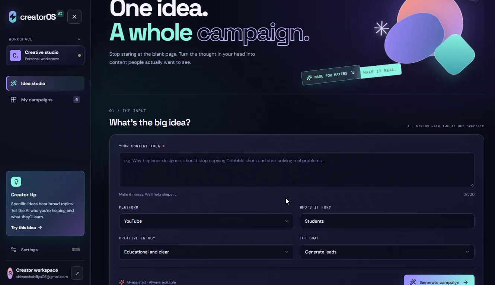
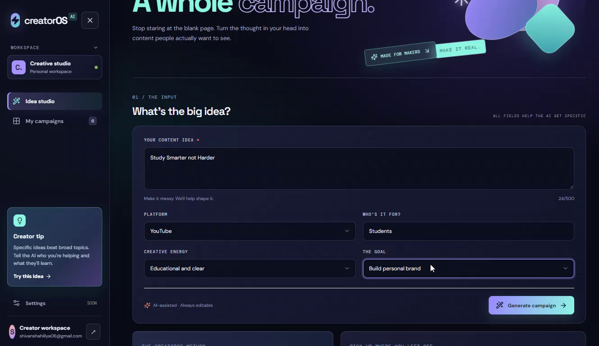
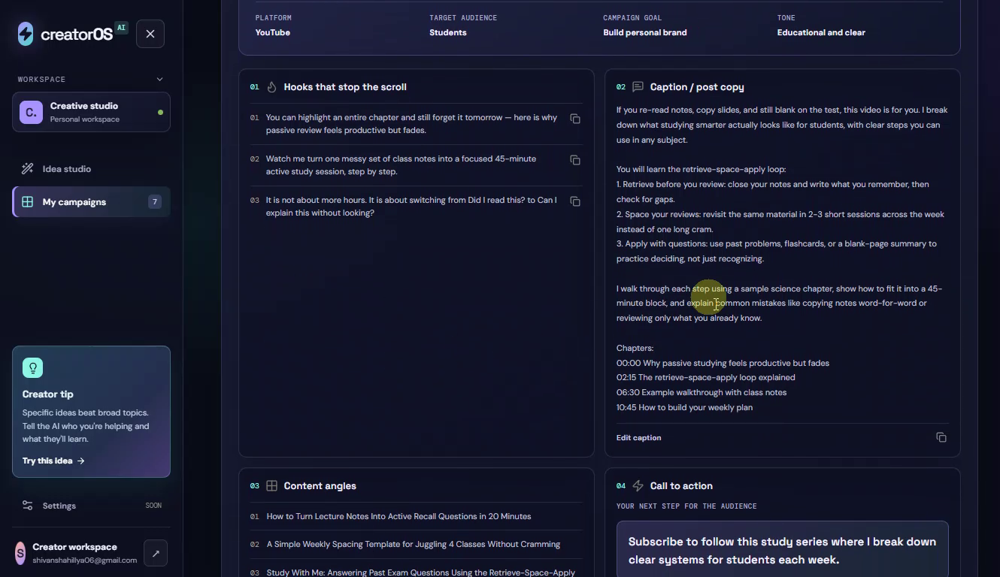
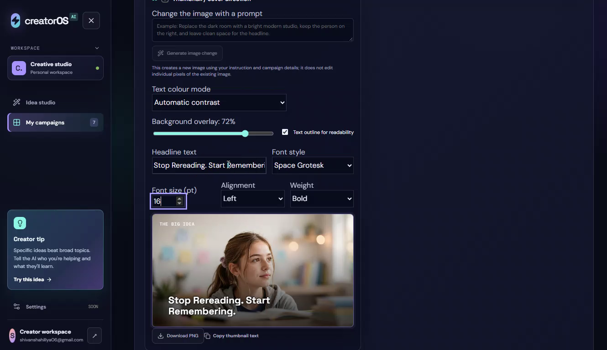
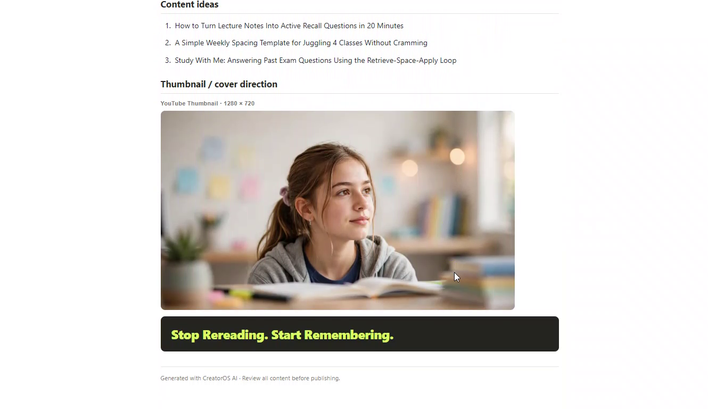

# CreatorOS AI

**One idea into a complete, ready-to-publish campaign — hooks, captions, CTA, and AI-generated thumbnails — in seconds.**

CreatorOS AI is a creator workspace for turning a single content idea into a structured campaign. Type an idea, choose the platform, audience and goal, and it generates a campaign you can review, edit and export as a PDF brief.

> **Demo video:** [Watch the 2:08 demo](https://drive.google.com/file/d/1nxYa3pBthc5SbVA-bTZTJvHo92AAkvvB/view?usp=drive_link) (edited cut from the original 4:40 recording — overlays added, slow typing and thumbnail editing fast-forwarded).
> **Live demo:** [creatoros-ai-mu.vercel.app](https://creatoros-ai-mu.vercel.app)

[](https://drive.google.com/file/d/1nxYa3pBthc5SbVA-bTZTJvHo92AAkvvB/view?usp=drive_link)



## What it does

From one idea, CreatorOS AI generates:

- **Campaign snapshot** — title, platform, target audience, campaign goal and tone
- **3 hooks that stop the scroll**
- **Caption / post copy** — a full, structured caption, not just a one-liner
- **Content ideas / angles** to build the campaign around
- **A clear CTA**
- **A thumbnail** — generated image with editable headline text overlaid in the app
- **A PDF brief** — export the whole campaign to share or use offline

### Example from the demo

Input: **“Study Smarter, Not Harder”** — YouTube, for Students, goal: Build personal brand.

Output: **“Study Smarter, Not Harder: A Practical System for Busy Students”**, with hooks, a detailed caption built around a retrieve–space–apply study loop, content ideas, a CTA, and a thumbnail headed **“Stop Rereading. Start Remembering.”**

## How it works

1. **Idea Studio** — enter your content idea and set the platform, audience and goal.
2. **Generate** — the app creates the full campaign in one pass.
3. **Review** — read the hooks, caption, content ideas and CTA, and open any saved campaign from **My Campaigns**.
4. **Thumbnail** — generate a thumbnail image, then tune it in the app: image prompt, headline text, text colour, background overlay, font style, font size, alignment and weight.
5. **Export** — download the campaign as a **PDF brief**.









## Built during the hackathon

Built solo during the **Meta Global AI Developer Hackathon, 26 October – 4 November 2026**.

Work built during the event:

- Migration of campaign generation to Meta's **Muse Spark** model family
- Thumbnail image generation, with headline text overlaid in the app's own UI (not baked into the image)
- Thumbnail editing controls and PDF brief export for the generated campaign

## Tech stack

- **Frontend:** React 18 + Vite
- **Backend:** Node.js + Express (`server/index.js`)
- **AI:** Meta Model API — Muse Spark (`muse-spark-1.3`) for campaigns, Muse Image (`muse-image-1.0`) for thumbnails
- **Auth & storage:** Supabase (sign-in, saved campaigns)
- **UI:** Custom CSS design system, Lucide icons
- **Images:** Sharp for thumbnail resizing per platform

## Run locally

### Requirements

- Node.js 20 or newer
- npm
- A Meta Model API key for real AI generation, plus Supabase project credentials (see `.env.example`)

### Steps

```bash
npm install
```

Copy the environment template and add your own key — never commit `.env`:

```bash
cp .env.example .env
```

Start the frontend and backend together:

```bash
npm run dev
```

- Frontend: the Vite URL shown in your terminal (normally `http://localhost:5173`)
- Backend health check: `http://localhost:8787/api/health`

If no API key is configured, the app runs in a clearly labelled demo mode.

## Project map

```
src/main.jsx       # React app, state, forms and campaign views
src/styles.css     # Design system and responsive layouts
src/lib/           # Shared helpers
server/index.js    # API endpoints and server-side AI integration
vite.config.js     # Vite config and local API proxy
.env.example       # Environment variable template (no real keys)
```

## What is not yet built

- Publishing directly to social networks
- Analytics from real platform APIs
- Per-account usage limits (the API currently has a basic per-IP rate limit)

A working demo is a starting point, not proof of product-market fit. Do not claim user growth or business results until measured.

## Contributing

This is a solo hackathon project. Issues and suggestions are welcome, but there is no contribution process or release schedule yet.
